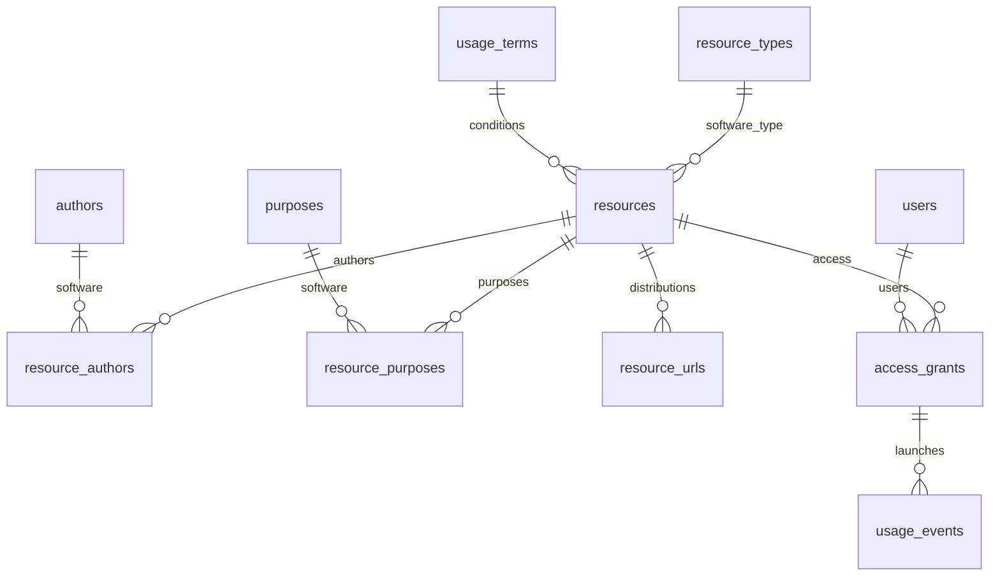

# Лабораторна робота №1 — завдання 3

**Левківський Євгеній Сергійович · ІПС-41**

Інформаційна система **«Програмне забезпечення на мережі факультету»**. Haskell, класи типів та instances, MySQL, 11 таблиць.

Зберігаються назва ПО, версія, автори, анотація, вид, термін і умови використання, адреси дистрибутивів, користувачі, популярність і статистика. `Resource` — загальна модель програмного ресурсу, `ResourceDraft` — дані введення.

```powershell
node scripts/local.mjs lab1 list
node scripts/local.mjs lab1 search GHC
node scripts/local.mjs lab1 catalog
node scripts/local.mjs lab1 details 1
node scripts/local.mjs lab1 stats
node scripts/local.mjs lab1 add "Нова програма" "1.0" "Анотація" 3 2 2026-10-01 -
node scripts/local.mjs lab1 update 4 "Оновлена програма" "2.0" "Нова анотація" 3 2 2026-10-01 2027-06-30
node scripts/local.mjs lab1 link-author 4 3
node scripts/local.mjs lab1 url-add 4 https://example.org/distribution.zip
node scripts/local.mjs lab1 grant 4 1
node scripts/local.mjs lab1 visit 4 1 120
node scripts/local.mjs lab1 edit authors 3 name "Левківський Євгеній Сергійович"
```

Команди виконуються з кореня репозиторію. Програма друкує ID після `add`; замість `4` використайте фактичний ID. Звіти: [PDF](report.pdf), [DOCX](report.docx), [Markdown](report.md).

`SqlValue` має instances для Text, Int, Day, Maybe a; UTF-8 текст кодується безпечним hex literal. `Validatable ResourceDraft` перевіряє назву, версію та дати. `ResourceStore MySQL` реалізує CRUD і пошук. Офіційний клієнт mysql — транспорт до справжнього сервера; основна логіка написана Haskell.



База: `faculty_software`. `resource_statistics` ранжує ПО за кількістю запусків і показує різних користувачів та тривалість. Зовнішні ключі забороняють використання без доступу, CHECK перевіряє термін використання. Схема і початкові дані відокремлені.
